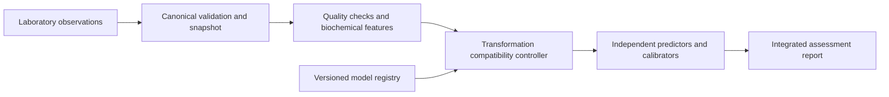

# PredictX

PredictX processes blood and urine laboratory observations through a common canonical representation and five independently fitted disease models. A request-scoped compatibility controller reuses numerical transformations when fitted preprocessing states match. FastAPI and Streamlit provide an integrated inference and reporting interface.

## Architecture



## Technical mechanism

The transformation key combines the feature-engine version with a digest of ordered features, fitted imputation and scaling parameters, observation indicators and training-domain bounds. Compatible diabetes and cardiovascular preprocessing states share one transformed vector. Each disease retains independent prediction parameters, calibration and input requirements.

## Model evaluation

| Assessment | Source dataset and endpoint | Model | Test records | AUROC (95% CI) |
|---|---|---|---:|---|
| Diabetes | NHANES 2017–2018, physician-diagnosed status | Gradient boosting | 1,011 | 0.923 (0.900–0.944) |
| Kidney | UCI CKD class | Gradient boosting | 80 | 1.000 (1.000–1.000) |
| Liver | ILPD liver-patient class | Multilayer perceptron | 114 | 0.760 (0.676–0.838) |
| Cardiovascular | NHANES CHD, MI or stroke history | Logistic regression | 1,039 | 0.785 (0.739–0.827) |
| Breast cancer | Senegal pretreatment CBC/CRP case-control cohort | Gradient boosting | 24 | 0.922 (0.804–1.000) |

Model development, calibration, evaluation and confidence-interval calculations are detailed in [Experimental methods](docs/methods.md). The breast cancer source cohort comprises 120 participants; its test subset contains 16 cases and eight controls.

## Computational results

On the recorded engineering fixture, integrated processing performs **38 canonical conversions**, compared with **190** across five full scalar processing pipelines. Fitted-state compatibility reduces **five transformations to four**. The recorded single-record median was **12.271 ms** for integrated scalar inference and **17.852 ms** for the five full pipelines; parallel workers recorded **5.553 ms**. Original benchmark samples and environment metadata are preserved in `results/refinement`.

## Installation

Use Python 3.12 and the pinned research dependencies.

```sh
python3.12 -m venv .venv
. .venv/bin/activate
pip install -r requirements.lock.txt
pip install --no-deps -e '.[test]'
```

## Run

```sh
uvicorn predictx.api:app --host 127.0.0.1 --port 8000
streamlit run demo/app.py --server.address 127.0.0.1 --server.port 8501
```

The API exposes `POST /research/predict`, `POST /research/predict/batch`, and `/schema/biomarkers`. Batch inference accepts up to 128 records.

## Reproduce

```sh
ruff check src scripts tests demo
ruff format --check src scripts tests demo
pytest -q
python scripts/evaluate.py
python scripts/benchmark_refined.py
python scripts/benchmark_model_loading.py
```

The evaluation scripts reproduce model discrimination, calibration, operating thresholds and inference parity from retained datasets and fitted artifacts. Original candidate fitting and nested development are available through `scripts/experiment.py` and `scripts/refine_models.py`. Reproduced outputs are written to `results/reproduced`.

## References

- [CDC NHANES 2017–2018](https://wwwn.cdc.gov/nchs/nhanes/continuousnhanes/default.aspx?BeginYear=2017)
- [UCI Chronic Kidney Disease](https://archive.ics.uci.edu/dataset/336/chronic+kidney+disease)
- [UCI Indian Liver Patient Dataset](https://archive.ics.uci.edu/dataset/225/ilpd+indian+liver+patient+dataset)
- Barry, N. O. K. [Systemic Hematological and Inflammatory Profiles in Triple-Negative Breast Cancer in a Senegalese cohort, version 1](https://data.mendeley.com/datasets/ck5gfhvbgz/1). DOI: 10.17632/ck5gfhvbgz.1.
