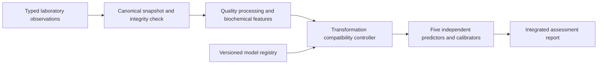

# PredictX

PredictX processes typed blood and urine laboratory observations through a common canonical representation and five independently fitted disease models. A request-scoped compatibility controller reuses numerical transformations when complete fitted preprocessing states match. FastAPI and Streamlit expose the same validated inference path.

## Architecture



## Technical contribution

The transformation key combines the feature-engine version with a digest of ordered inputs, fitted imputation and scaling state, observation indicators and training-domain bounds. Compatible diabetes and cardiovascular preprocessing states share one transformed vector. Each patient retains separate feature and transformation caches; each disease retains its predictor, calibrator and input contract.

## Predictive models and experimental results

| Assessment | Source dataset and endpoint | Model | Test n | AUROC (95% CI) |
|---|---|---|---:|---|
| Diabetes | NHANES 2017–2018, DIQ010 diagnosed status | Gradient boosting | 1,011 | 0.923 (0.900–0.944) |
| Kidney | UCI CKD class | Gradient boosting | 80 | 1.000 (1.000–1.000) |
| Liver | ILPD liver-patient class | Independent MLP | 114 | 0.760 (0.676–0.838) |
| Cardiovascular | NHANES CHD/MI/stroke history | Logistic regression | 1,039 | 0.785 (0.739–0.827) |
| Breast cancer | Senegal pretreatment CBC/CRP case-control cohort | Gradient boosting | 24 | 0.922 (0.804–1.000) |

These source-cohort results reproduce from retained artifacts and fixed partitions. Statistical methods, cohort interpretation and per-model reporting modes are described in [Methods](docs/methods.md). The breast cohort contains 120 women; its test subset contains 16 cases and eight controls.

The patent's engineering fixture yields **190 → 38 canonical conversions** and **5 → 4 fitted transformations** when comparing five full pipelines with integrated execution. Recorded single-record medians were 17.852 ms and 12.271 ms, respectively; parallel workers recorded 5.553 ms. Frozen measurements reside in `results/refinement`; fresh runs write to `results/reproduced`. Timing and memory depend on the measured process arrangement and host.

## Installation

Python 3.12 matches the retained model environment.

```sh
python3.12 -m venv .venv
. .venv/bin/activate
pip install -r requirements.lock.txt
pip install --no-deps -e '.[test]'
```

## Usage

```sh
uvicorn predictx.api:app --host 127.0.0.1 --port 8000
streamlit run demo/app.py --server.address 127.0.0.1 --server.port 8501
```

The API provides `POST /research/predict`, `POST /research/predict/batch` (up to 128 records), `/schema/biomarkers` and `/docs`.

```sh
curl http://127.0.0.1:8000/research/predict \
  -H 'Content-Type: application/json' \
  --data-binary @results/refinement/SYNTHETIC_benchmark_input.json
```

The fixture is an explicitly synthetic engineering record. Assessments include source endpoints, calibrated scores, model hashes, coverage, quality codes and per-model abstention status.

## Reproducibility

```sh
ruff check src scripts tests demo
ruff format --check src scripts tests demo
pytest -q
python scripts/evaluate.py
python scripts/benchmark_refined.py
python scripts/benchmark_model_loading.py
```

Evaluation verifies source hashes, partition disjointness, training-fitted preprocessing, calibration, saved predictions, operating thresholds and runtime parity. It regenerates ROC, calibration and confusion-matrix figures for each disease. Optional independent candidate fitting and nested development use `python scripts/experiment.py` and `python scripts/refine_models.py`; their outputs are separate from the deployed artifacts.

See [Patent alignment](docs/patent_alignment.md) for the implementation map and [Verification](docs/verification.md) for the reconstruction checks.

## References

- [CDC NHANES 2017–2018 data and documentation](https://wwwn.cdc.gov/nchs/nhanes/continuousnhanes/default.aspx?BeginYear=2017).
- [UCI Chronic Kidney Disease](https://archive.ics.uci.edu/dataset/336/chronic+kidney+disease).
- [UCI Indian Liver Patient Dataset](https://archive.ics.uci.edu/dataset/225/ilpd+indian+liver+patient+dataset).
- Barry, N. O. K. [Systemic Hematological and Inflammatory Profiles in Triple-Negative Breast Cancer in a Senegalese cohort, version 1](https://data.mendeley.com/datasets/ck5gfhvbgz/1), DOI 10.17632/ck5gfhvbgz.1, CC BY 4.0.
